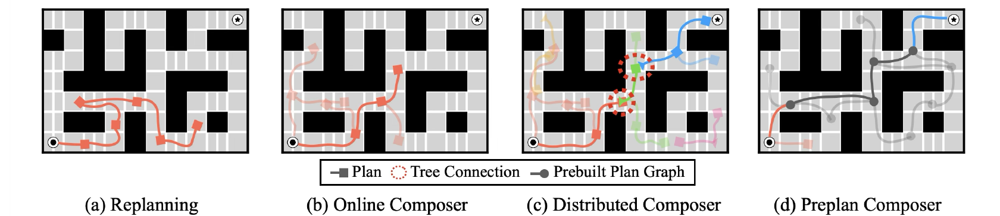

# Compositional Monte Carlo Tree Diffusion (C-MCTD)

This repository provides the **official PyTorch implementation** of Compositional Monte Carlo Tree Diffusion (C-MCTD). C-MCTD extends [Monte Carlo Tree Diffusion (MCTD)](https://github.com/ahn-ml/mctd) from searching within a single trajectory to searching over compositions of complete plans, which lets a diffusion planner trained on short trajectories solve long-horizon tasks such as the PointMaze and AntMaze Stitch tasks of [OGBench](https://seohong.me/projects/ogbench/).

## Compositional Monte Carlo Tree Diffusion (C-MCTD)

Author: Jaesik Yoon, Hyeonseo Cho, Sungjin Ahn

_Published in Advances in Neural Information Processing Systems (NeurIPS) 2025, Spotlight._

[[Paper]](https://arxiv.org/abs/2510.21361)



Replanning stitches plans one after another and makes myopic decisions (a). C-MCTD searches over plan compositions with three composers:

- **Online Composer** (b): a plan-level tree search in which every node stitches a complete diffusion plan onto its parent's plan, with guidance sets as meta-actions and fast replanning for simulation.
- **Distributed Composer** (c): trees grown in parallel from several origins (cluster centers of the dataset), connected where their plans meet, and a shortest route over the connections.
- **Preplan Composer** (d): a plan graph between waypoints built offline; at inference only the connections from the start and to the goal are searched.

This release modernizes the node planner as well: each plan segment is searched with MCTD over its denoising process (Parallel MCTD), the plan budget counts moving points only, and the composers run their trees in parallel batches.

## Installation

We recommend using Docker to set up the environment for reproducibility.

**1. Download MuJoCo binaries:**
Our Docker setup requires the MuJoCo 2.1.0 binaries. Please download them from this [link](https://drive.google.com/drive/folders/1gwXsIzpTILXG6kZv1EDrLBeEKYpPAl-G?usp=drive_link) and place the `mujoco210` directory into `./dockerfile/mujoco/`. The final path should look like `./dockerfile/mujoco/mujoco210`.

**2. Build the Docker image:**

From the root of the repository, build the image with your user and group IDs so that files written to the mounted repository stay writable:

```bash
docker build -t cmctd --build-arg UID=$(id -u) --build-arg GID=$(id -g) dockerfile
```

> **Note on the environment:** The Dockerfile installs a customized version of the [OGBench](https://seohong.me/projects/ogbench/) benchmark (`dockerfile/ogbench-1.0.1-py3-none-any.whl`). This customization incorporates velocity into the maze environment's observation space and removes randomness from the start and goal positions to reduce performance variance. Stock OGBench is not interchangeable with it.

**3. Run commands in the container:**
`scripts/docker_run.sh` runs a command inside the image with the repository mounted at `/workspace` and the OGBench dataset cache (`~/.ogbench/data`, downloaded on first use) mounted inside the container. `CMCTD_IMAGE`, `CMCTD_GPUS` (a GPU id or `none`) and `CMCTD_DATASETS` override the image, GPU and dataset cache. To compare your environment with the one used for the reported results:

```bash
CMCTD_GPUS=none bash scripts/docker_run.sh python3 scripts/check_environment.py
```

Logging to Weights & Biases is optional and disabled by default (`wandb.mode=disabled`).

## Evaluation

### 1. Download Pre-trained Models

Download the pre-trained models from this [link](https://drive.google.com/drive/folders/1a1ohcAqmRWyWe66XDF6EWHmw9Fn_MbeP) and extract the archives from the repository root; they keep the paths expected by the code.

| Archive | Contents |
|---|---|
| [`cmctd_pointmaze_planner_weights.tar.gz`](https://drive.google.com/file/d/1uXFY6sFJ3lqzHOFvE_HZdmIDyt0OQzRD/view) | PointMaze Medium/Large/Giant Stitch diffusion planners |
| [`cmctd_antmaze_planner_weights.tar.gz`](https://drive.google.com/file/d/1lu8TboWI8McxFLwLLkfva570T0MR7e7w/view) | AntMaze Medium/Large/Giant Stitch diffusion planners |
| AntMaze controllers: [Medium](https://drive.google.com/file/d/1eke-2cd9cxpPhoLggIzolm2UcWc9uVzz/view), [Large](https://drive.google.com/file/d/1ufAjMfQG7xYFA1Q8lLnKujdkW4BIxuv2/view), [Giant](https://drive.google.com/file/d/1qNhC61FkxjsT7f-D9E81BakR8dIfZZpi/view) | Diffusion-QL low-level controllers (`dql/results/`) |

The planners are extracted to `outputs/downloaded/jaesikyoon/jsik_c_mctd/<id>/model.ckpt`:

| Maze | Medium | Large | Giant |
|---|---|---|---|
| PointMaze | `hch2ps15` | `mpiz751c` | `gk090u4y` |
| AntMaze | `949zv6vw` | `ut6p4783` | `md6zu92y` |

The waypoints (cluster centers) and the Preplan graphs are included in `graphs/`. PointMaze uses a PD controller and needs no controller weights; AntMaze uses Diffusion-QL controllers trained on the Navigate datasets.

### 2. Run the Evaluation

```bash
bash scripts/docker_run.sh python3 scripts/cmctd.py evaluate \
  --maze pointmaze --size medium --composer online --task 1 --seed 0 \
  --checkpoint outputs/downloaded/jaesikyoon/jsik_c_mctd/hch2ps15/model.ckpt \
  --output outputs/eval/pointmaze-medium-online-task1-seed0
```

- `--maze`: `pointmaze` or `antmaze`; `--size`: `medium`, `large` or `giant`; `--task`: 1–5; `--seed`: planner seed.
- `--composer`: `online`, `distributed`, `preplan`, or `replan` (the baseline without search: 100-step segments are chained from the end of the plan, then the whole plan is executed).
- `--output` must be a new directory. It stores the Hydra configuration, the selected plan (`plan.npz`) and the executed trajectory (`execution.npz`). A case where no plan is found counts as a failure.
- `--override KEY=VALUE` passes additional Hydra overrides and `--dry-run` prints the command without running it.

The settings are the defaults in `configurations/algorithm/df_planning.yaml` plus the per-map presets in `configurations/release/pointmaze_presets.json` and `configurations/release/antmaze_presets.json` (warp threshold 0.5 on Medium/Large and 1.0 on Giant, Online search budget 1000 / 1000 / 2000, and on AntMaze plan rank 1 on Medium/Large and 5 on Giant).

The reported results aggregate tasks 1–5 and seeds 0–9: the success rate is averaged over the five tasks for each seed, then the mean and standard deviation are taken over the ten seeds.

For AntMaze, a saved plan can be re-executed with a different controller seed to separate plan quality from controller variance (a turned-over ant). For example, after evaluating AntMaze Medium (Online Composer, task 1, seed 0) into `outputs/eval/antmaze-medium-online-task1-seed0`:

```bash
bash scripts/docker_run.sh python3 scripts/cmctd.py evaluate \
  --maze antmaze --size medium --composer online --task 1 --seed 0 \
  --checkpoint outputs/downloaded/jaesikyoon/jsik_c_mctd/949zv6vw/model.ckpt \
  --output outputs/eval/replay-seed1 \
  --override algorithm.high_level_search=replay-plan \
  --override algorithm.replay_plan_path=/workspace/outputs/eval/antmaze-medium-online-task1-seed0/plan.npz \
  --override algorithm.controller_seed=1
```

### 3. Results

Success rate (%) and steps to the goal of the successful runs. For AntMaze, in parentheses, the success when a failure whose ant turned over counts as a success if a replay of its plan with controller seeds 1–10 reaches the goal. Replan uses the same planner, scoring and controller without the search.

| PointMaze | Medium | Large | Giant |
|---|---|---|---|
| Replan | 90.0 ± 10.0, 308 | 42.0 ± 14.0, 567 | 20.0 ± 17.9, 799 |
| Online | 100.0 ± 0.0, 198 | 100.0 ± 0.0, 426 | 94.0 ± 9.2, 758 |
| Distributed | 100.0 ± 0.0, 171 | 100.0 ± 0.0, 303 | 98.0 ± 6.0, 526 |
| Preplan | 100.0 ± 0.0, 159 | 100.0 ± 0.0, 275 | 100.0 ± 0.0, 523 |

| AntMaze | Medium | Large | Giant |
|---|---|---|---|
| Replan | 98.0 ± 6.0 (100), 256 | 68.0 ± 18.3 (70), 550 | 50.0 ± 20.5 (60), 720 |
| Online | 100.0 ± 0.0 (100), 222 | 98.0 ± 6.0 (100), 430 | 58.0 ± 18.9 (72), 773 |
| Distributed | 92.0 ± 9.8 (96), 213 | 96.0 ± 8.0 (100), 397 | 62.0 ± 16.6 (84), 711 |
| Preplan | 100.0 ± 0.0 (100), 221 | 100.0 ± 0.0 (100), 395 | 94.0 ± 12.8 (100), 709 |

## Building the Preplan Graphs

The Preplan graphs in `graphs/<maze>_online_2026-09-28/` were built with the Online search, one tree per waypoint pair. To rebuild one, search the pairs in shards (one process per GPU) and collect them:

```bash
# shard k of 8 (k = 0..7)
bash scripts/docker_run.sh python3 scripts/cmctd.py evaluate --maze pointmaze --size giant --composer preplan \
  --checkpoint <model.ckpt> --output outputs/edges/shard$k \
  --override algorithm.high_level_search=preplan-edges \
  --override "algorithm.preplan_edge_shard=[$k,8]" --override algorithm.preplan_edge_dir=outputs/edges/pairs
bash scripts/docker_run.sh python3 scripts/build_preplan_graph.py --edges outputs/edges/pairs --nodes 70 \
  --out graphs/pointmaze_online_2026-09-28
```

## Training

### Diffusion planner

```bash
bash scripts/docker_run.sh python3 scripts/cmctd.py train-planner \
  --maze pointmaze --size medium --seed 0 --output outputs/train/pointmaze-medium
```

The planners are trained on the Stitch datasets. Checkpoints are written under `<output>/hydra/checkpoints/`, and the defaults are in `configurations/experiment/exp_planning.yaml`.

### AntMaze low-level controller

```bash
bash scripts/docker_run.sh python3 scripts/cmctd.py train-controller \
  --maze antmaze --size medium --seed 0 --output outputs/train/controller-medium
```

This trains the Diffusion-QL controller on the Navigate dataset. To evaluate with it, pass `--override algorithm.controller_checkpoint_dir=/workspace/<output>/<experiment>` (and `algorithm.controller_checkpoint_epoch` if needed).

## Tests

```bash
CMCTD_GPUS=none bash scripts/docker_run.sh python3 -m unittest discover -s tests
```

## References

If you find our work useful, please consider citing:

```bibtex
@inproceedings{yoon2025compositional,
  title={Compositional Monte Carlo Tree Diffusion for Extendable Planning},
  author={Yoon, Jaesik and Cho, Hyeonseo and Ahn, Sungjin},
  booktitle={Advances in Neural Information Processing Systems},
  year={2025}
}
```

## Acknowledgement

This implementation builds on [MCTD](https://github.com/ahn-ml/mctd) and [Diffusion Forcing](https://github.com/buoyancy99/diffusion-forcing). The low-level controller is based on [Diffusion-QL](https://github.com/Zhendong-Wang/Diffusion-Policies-for-Offline-RL).

This repo is forked from [Boyuan Chen](https://boyuan.space/)'s research template [repo](https://github.com/buoyancy99/research-template). By its MIT license, you must keep the above sentence in `README.md` and the `LICENSE` file to credit the author.
